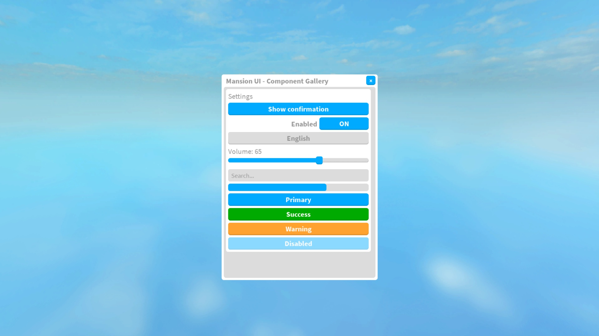

# mansion-ui-library-rblx

A standalone Roblox UI library and visual-reference archive extracted from the provided `mansion.rbxl` place. It includes the place's white/gray/cyan UI and its custom `MatrikzGUI` visual templates.



## Included

- **7,841 UI objects across 479 root trees**, with hierarchy, readable writable visual properties, attributes, tags, sprite crops, nine-slice rectangles, font faces, layout objects and constraints.
- **377 image IDs / 2,394 image uses**, including **156 downloaded original images**. The remaining 221 returned HTTP errors from Roblox asset delivery; their IDs and implementation metadata remain in the catalog.
- Reusable windows, panels, sections, buttons, image buttons, labels, icons, inputs, live search, dropdowns, toggles, sliders, RGB controls, progress bars, notifications, tooltips, dialogs and overlays.
- Rounded corners, strokes, gradients, padding, lists, grids, scrolling, screen/surface/billboard containers, canvas groups and viewports. `Create` exposes arbitrary native classes and all their writable properties and events.
- Light/dark theme tokens, button states, focus/hover/press effects, cleanup, scaling, exact-template cloning, and a standalone counterpart for every method name in the source GUI handler.

## Install

1. Download [`dist/MansionUI.rbxm`](dist/MansionUI.rbxm) and insert it into **ReplicatedStorage** using Studio's Insert from File.
2. Name the ModuleScript **MansionUI**.
3. Require it from a LocalScript. Open [`dist/MansionUI-Gallery.rbxl`](dist/MansionUI-Gallery.rbxl) and press Play for the live examples.

```lua
local UI = require(game.ReplicatedStorage.MansionUI)
local screen = UI.Screen(game.Players.LocalPlayer:WaitForChild("PlayerGui"))
local window = UI.Window(screen, "Settings")
local section = UI.Section(window.Body, "Game settings")

UI.Toggle(section, "Enabled", true, function(value)
    print(value)
end)
UI.Dropdown(section, {"English", "French", "Japanese"}, "English", print)
UI.Slider(section, "Volume", 0, 100, 65, 1, print)
UI.Button(section, "Save", function()
    UI.Notify(screen, "Saved", "Your settings were updated.", 3)
end)
```

For exact source visuals, clone a template and wire your own behavior:

```lua
local options, errors = UI.Clone(
    "StarterGui.MainGUI.Design Lounge Chair.MatrikzGUI.OptionsFrame",
    screen,
    {Visible = true}
)
assert(#errors == 0, table.concat(errors, "\n"))
options.Close.Activated:Connect(function()
    options.Visible = false
end)
```

`UI.Templates.List("Toggle")` searches the entire catalog. Use a full path or numeric ID when names repeat. Clone returns the instance, property-assignment errors, and an ID-to-instance map. Cloned templates preserve their saved visibility; set `Visible=true` or `Enabled=true` as needed. They contain visual objects only; interactions are added through the library or your own code.

## Visual reference

Download/clone this repository and open [`reference/index.html`](reference/index.html) in a browser. It works offline, with searchable original assets, unavailable-asset entries, cropped and tinted sprite previews, source paths and implementation details.

| Folder | Contents |
| --- | --- |
| `src/` | Standalone Luau library and generated template data |
| `assets/images/` | 156 original image files |
| `assets/manifest.json` | Every image use, URI, crop, tint, slice and source path |
| `assets/download-status.json` | Download outcome for every numeric image ID |
| `reference/snapshot.json` | Inspectable typed source UI snapshot |
| `reference/style-tokens.json` | Observed colors, fonts, corners and strokes with counts |
| `reference/coverage.json` | Class counts and explicit omissions |
| `docs/` | API, design anatomy, compatibility and verification |
| `examples/` | Runnable LocalScript component gallery |
| `dist/` | Importable library model and standalone demo place |

## Build and verify

Requires Node.js and Rojo 7.7+:

```sh
node tools/generate.mjs
node tools/gallery.mjs
node tools/verify.mjs
rojo build default.project.json -o dist/MansionUI.rbxm
rojo build demo.project.json -o dist/MansionUI-Gallery.rbxl
```

`node tools/download-assets.mjs` retries public asset delivery and records unavailable originals. It uses no account cookies or credentials.

Studio verification reconstructed **all 7,841 objects with zero assignment failures or property mismatches**. The behavioral suite passes **23 assertions**. See [`docs/VERIFICATION.md`](docs/VERIFICATION.md).

## Scope and provenance

Exact templates reproduce exported UI data. The higher-level components recreate the observed style with a new standalone implementation. Source helper names are covered, but signatures use the documented standalone API; this is not a drop-in replacement for the source game's modules. Gameplay-specific prompt names render caller-supplied UI and callbacks. They do not implement purchases, permissions, rewards or game services.

The archive excludes source-place scripts, gameplay code, 3D viewport contents, external object references, localization tables and runtime-only state. Intermediate non-UI ancestors become inert Folders. Eighty-four omitted Content values are redundant scrollbar content wrappers; the corresponding legacy string image properties are preserved. Missing assets can remain unavailable in other experiences due to Roblox access settings. See [`docs/COMPATIBILITY.md`](docs/COMPATIBILITY.md).

Original art, names and UI template designs retain their original provenance; this repository does not assign them a new license. Newly written code is identified separately in [`CONTRIBUTIONS.md`](CONTRIBUTIONS.md).
