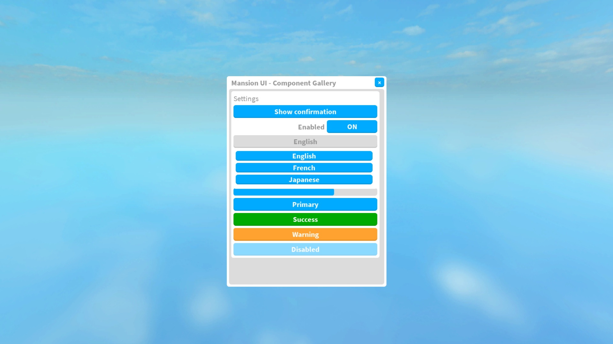
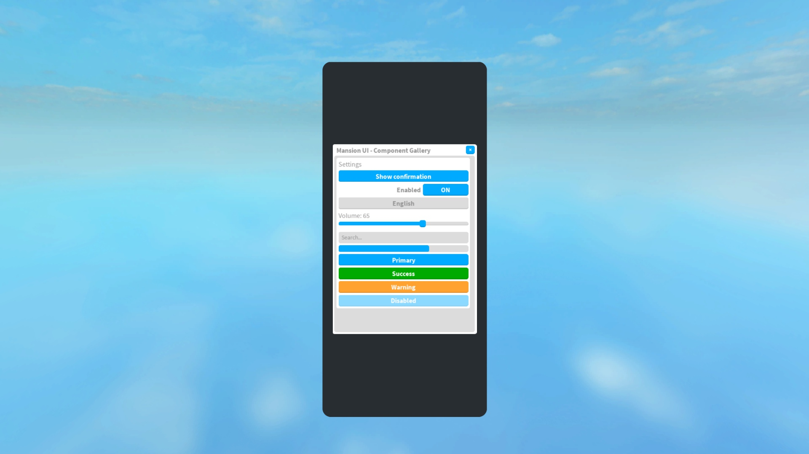
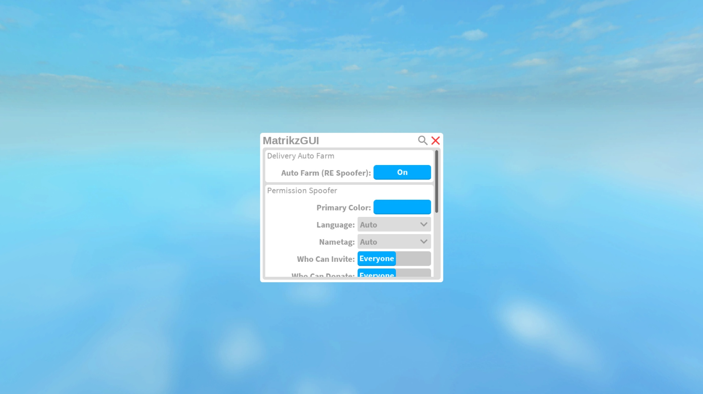

# Verification

Executed in Roblox Studio on 2026-10-24:

- Reconstructed all 479 exported root trees, covering 7,841 UI objects.
- Zero property assignment errors.
- Zero mismatches between reconstructed exported property values and the typed snapshot. Internal reference records were resolved separately; non-UI content is outside the export.
- Passed 23 behavioral assertions in `tests/Studio.spec.luau`: nine-slice properties, disabled/re-enabled controls, callback counts, silent updates, dropdown replacement and invalid choices, slider quantization/clamps, progress bounds, theme propagation, RGB state, exact custom-template structure, phone scaling and single dialog completion.
- Built the importable model and demo place with Rojo 7.7.0.
- Verified a real mouse click changes the toggle from ON to OFF.
- Visually checked the desktop gallery, dropdown overlay, exact custom template, and a simulated 390×844 clipped viewport (scale 0.684). Dropdown opening raises its row to ZIndex 50, and closing restores ZIndex 1.
- Console inspection found Studio/plugin/CorePackages warnings but no library runtime errors during gallery testing.







Run the behavioral suite after importing the model to ReplicatedStorage:

```lua
-- Insert tests/Studio.spec.luau as a ModuleScript named StudioSpec.
print(require(game.ReplicatedStorage.StudioSpec)(require(game.ReplicatedStorage.MansionUI)))
```

The structural audit and behavioral suite run on detached instances without executing source-place scripts. Rendered screenshots come from the separately generated gallery place. Property verification establishes snapshot reconstruction, not that inaccessible original image assets load in every experience. Device scaling and slider gamepad key handling are implemented; exhaustive physical touch/gamepad hardware testing was not performed.
